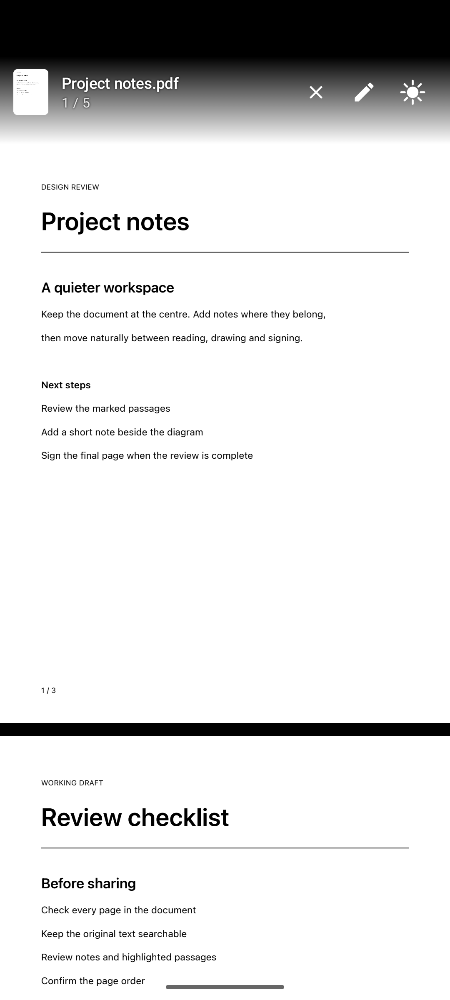
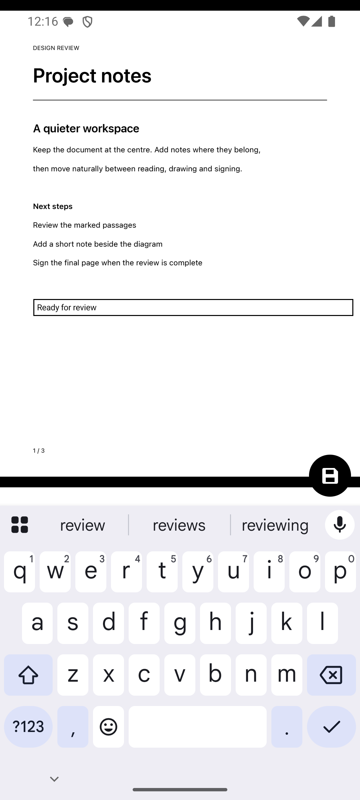
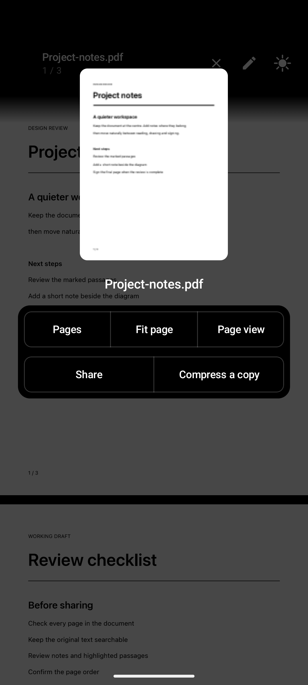
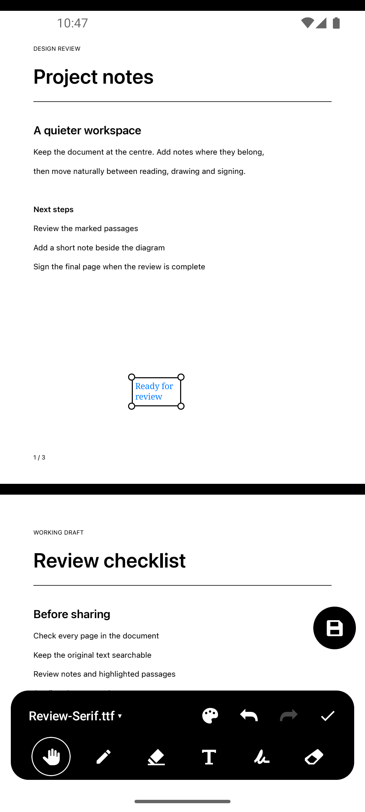
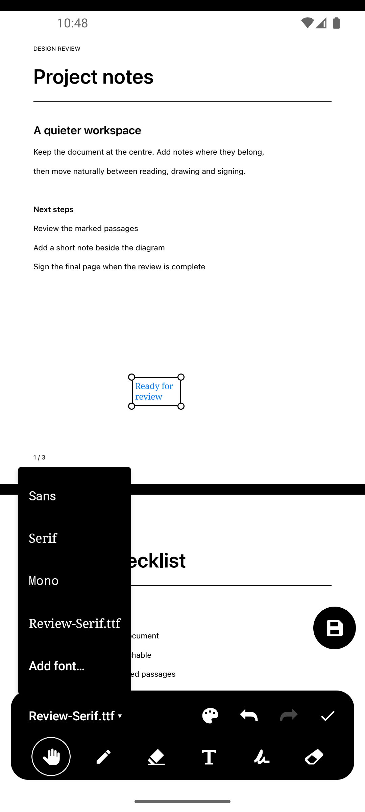
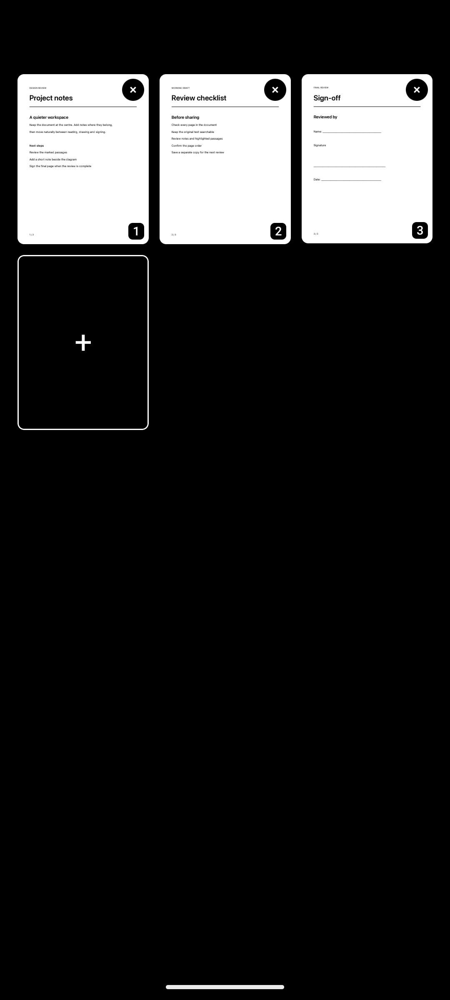
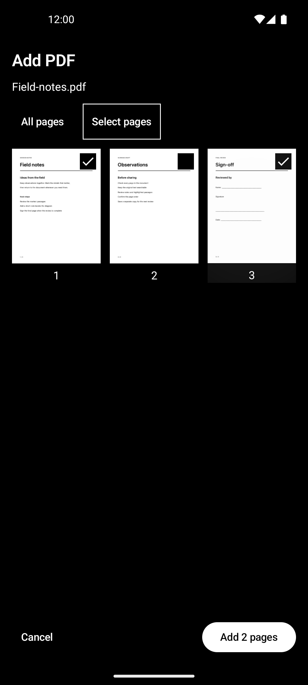
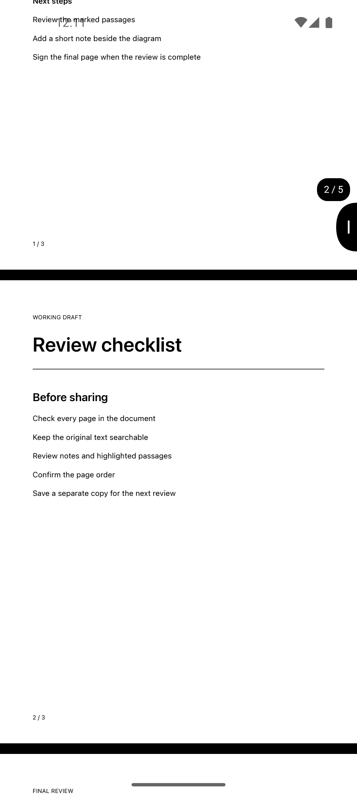

# PDF Editor

A minimal, fully offline Android PDF reader and annotation editor. Read the whole
PDF, then reveal tools only when you need them. Pure-black controls, an unobtrusive
compact black header, and normal PDF colours keep the document at the centre.

[Download the latest APK](https://github.com/AbinavPallathoor/Android-PDF-Editor/releases/latest)

- Annotate any page with pen strokes, highlights, text, and reusable signatures.
- Type directly on the page; resize selected text boxes with corner handles.
- Use Hand while editing to select and move drawings, signatures, and text.
- Change text colour and fonts from the contextual tray. Sans, Serif, and Mono are included; import additional static TrueType fonts locally.
- Switch between scrolling and page-by-page views, zoom/pan, and copy PDF text.
- Swipe the document title to move between recent PDFs, with drafts kept intact.
- At the start of a document, the header appears automatically above the PDF.
- Drag the curved edge scrollbar to browse pages; its page number appears above the handle.
- Open a bottom panel for page/view and file controls; rename directly in its title.
- Reorder or delete pages, or add an entire PDF or selected pages, with document-wide undo/redo and draft recovery.
- Save from the bottom-right corner: create a new file, explicitly replace a writable original, or discard all changes.
- Unsaved work remains editable in a private draft. Closing or switching PDFs never writes to the original.
- PDFs handed off with temporary access are kept as imported copies in Recents; their external originals stay unchanged.
- Share the complete annotated PDF while retaining its original text and vectors.

PDF colour inversion and layout are remembered per document. The app has no
`INTERNET` permission, accounts, ads, analytics, Firebase, or Google Play Services.
It is Apache-2.0 licensed; dependency and font licenses are in
[THIRD_PARTY_LICENSES](THIRD_PARTY_LICENSES).

## Screenshots

Screenshots show a synthetic sample document; no personal files are included. The gallery was captured for v0.2.2; the current header is solid black.

| Reading | Inline text |
| --- | --- |
|  |  |
| **Document controls** | **Editing** |
|  |  |
| **Text styling** | **Page management** |
|  |  |
| **Selected-page import** | **Edge navigation** |
|  |  |

## Build and validate

Requires JDK 21 and Android SDK 36; minimum Android version is 8.0 (API 26).
On this machine set `JAVA_HOME=/opt/homebrew/opt/openjdk@21` before Gradle.

```sh
./gradlew assembleDebug
./gradlew installDebug
./gradlew test ktlintCheck
./gradlew connectedDebugAndroidTest  # running emulator/device required
./gradlew assembleRelease
```

Tests cover document-wide history, page identity, draft recovery, editable PDF
round-trips, source conflicts, incoming file intents, real multipage editing and
saving, text selection, layouts, pinch cancellation, and rotated/cropped pages.
See the [v0.2.3 validation](docs/validation/2026-10-16-v023.md),
[document controls validation](docs/validation/2026-10-16-document-controls.md),
[v0.2.1 validation](docs/validation/2026-10-16-v021.md),
[v0.2.0 validation](docs/validation/2026-10-16-v020.md) and
[PDF validation record](docs/validation/2026-10-15-multipage-editor.md) for test
results, screenshots, manual save checks, and coverage limits.

## Current limits

- Annotations created by this app can be edited again. Other applications'
  annotations are preserved, but are not imported into this app's editable model.
- Android's platform renderer omits some annotation types, especially foreign
  Ink. App-owned annotations are displayed with the editor's own overlay;
  text/highlight rendering flags are enabled on API 35+. Some simple external
  viewers may likewise omit editable annotations; standards-aware viewers such
  as PDFKit render the saved appearance streams.
- Copying requires an existing text layer. OCR and encrypted PDFs are not supported.
- Bundled fonts support common Latin, Greek, and Cyrillic text. Extra fonts
  can be imported as static TrueType (.ttf or TrueType-outline .otf) files up to
  16 MiB. Variable fonts, CFF, font collections, and web fonts are unsupported.
  Unsupported glyphs produce a save error with the draft retained; complex-script
  shaping has not been validated. Custom fonts are embedded for editable reopening.
- SAF providers control replacement semantics; replacement cannot be guaranteed
  atomic across every provider. Drafts/backups are retained on failure.

## License

Apache License 2.0 — see [LICENSE](LICENSE).
