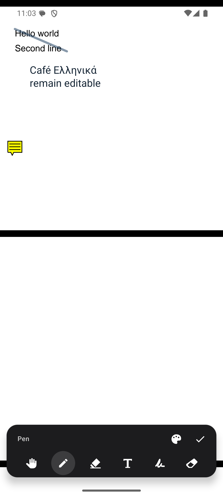

# Minimal UI restoration — 15 October 2026

Restored the existing gradient `DocumentTitleBar`, thumbnail expansion, monochrome
icons, and document-switch animation around the new multipage editor. The PDF
fills the reader. Idle controls fade; a Hand tap brings them back. Edit hides the
header immediately and opens a compact floating tray. Done returns to reading.
Colours, history actions, selection actions, and the save icon appear only in
their relevant contexts. Pages/layout/fit/share/compress live in the expanded
document panel.

## Verification

```sh
./gradlew :app:ktlintCheck test :app:connectedDebugAndroidTest :app:assembleRelease
```

- 84 JVM tests passed in each of debug and release.
- All 21 API 35 emulator tests passed, including production Activity opening,
  signatures and ink across pages, save/reopen, inversion preferences, selection,
  layouts, zoom, and the new contextual UI checks.
- New checks cover idle hide/tap reveal, editing-only tools, requested colour
  controls, last-page content above the tray, and expanded actions on a short
  screen.
- Reviewed the source and fixed both reported layout problems: the measured tray
  supplies trailing scroll space and reduces the paged viewport; the expanded
  thumbnail/panel adapt to screen height and the panel can scroll.
- The production integration test caught the header intercepting an early pen
  stroke; entering Edit now hides it immediately. Save tests wait for the actual
  asynchronous dirty-state update before interacting with Save.
- Visually checked reading, editing, and the expanded document panel on the
  visible Android emulator. Reinstalled the debug build and left the app open.
- Release APK: 8,352,271 bytes (7.97 MiB). The existing R8 metadata compatibility
  warnings remain; the optimized build completes. No dependency was added.
- `git diff --check` passed. No commit or push was made.

This remains emulator validation, not physical-device validation. PDF backend
behaviour and existing limitations are recorded in the [multipage validation
record](2026-10-15-multipage-editor.md).

## Runtime screenshots

Reading after idle:


Editing after tapping the pencil:



Document actions after tapping the title/thumbnail:


