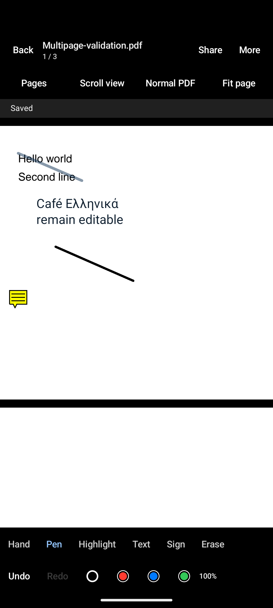

# Multipage editor validation — 15 October 2026

Implemented against the user's approved document-wide annotation workflow. The
editor keeps the original PDF content and writes standard editable annotations;
it does not replace pages with screenshots. PDFBox remains the editing backend.

## Automated checks

Environment: JDK 21, existing AGP/Kotlin versions, Android 15/API 35 arm64 emulator
`pdfeditor_test`. Commands completed successfully:

```sh
./gradlew :app:ktlintCheck test :app:connectedDebugAndroidTest :app:assembleRelease
```

- 84 JVM tests passed in debug and 84 in release, with no failures or errors.
- All 17 instrumented tests passed. They exercise the production Activity,
  navigation, PDFBox, platform rendering, and Compose touch input.
- An additional run of the ink/navigation/save-menu test passed after adding a
  pixel assertion that unchanged toolbar text stays visible after drawing.
- A final `ktlintCheck` and `git diff --check` passed.
- Release APK: 8,319,503 bytes (7.93 MiB), below the 15 MiB budget.
- Release manifest inspection with `aapt dump permissions` found only the
  app-local dynamic receiver signature permission. No Internet or broad storage
  permission is present.

Coverage includes multipage ink/text/signatures, editable annotation round-trips,
foreign annotation preservation, rotated/cropped pages, stable page identity,
reorder/delete/append history, draft recovery, external source changes, explicit
replacement/backups, failed saves, cold/warm VIEW, picker result permissions,
remembered inversion, continuous/paged layouts, selection/Copy, pinch zoom and
cancellation of ink when a second finger starts navigating.

## Manual runtime and independent PDF checks

- Opened a real three-page PDF through ACTION_VIEW in the emulator. Its source
  contained original text, editable Ink/FreeText/Highlight/signature objects,
  and a foreign sticky note. Normal page colours, readable controls, and imported
  app-created annotations were visible.
- Added ink, opened the corner save menu, selected **Save as new file**, and
  completed Android's actual CreateDocument picker in Downloads. The app showed
  **Saved** and removed the dirty icon.
- Pulled the resulting PDF and opened it with macOS PDFKit independently of the
  Android backend. It retained all three pages, original text, all existing
  annotations, and the added stroke. Annotation counts changed from 3/0/2 to
  4/0/2 across its three pages.
- Compared the original before and after saving a new copy: both SHA-256 values
  were `1b099c319d5ae10d88d08b587c783691d4715c288133b742bb1b9c557bb7b453`.
- Separately rendered the generated appearance streams in PDFKit, including
  multiline Greek text, highlights, signatures, and a cropped/rotated page.
- Installed a temporary debug-key-signed copy of the optimized release APK;
  source opening, annotation restoration, and adding ink worked. The ordinary
  debug APK was reinstalled afterward for continued development.
- A second source review found no remaining material issue after its reported
  metadata, gesture, bounds, append-history, and opacity issues were fixed.

The runtime check also caught missing production PDFBox initialization and a
black inherited text colour. Both were fixed with regressions that first failed
and then passed. A later apparent missing-text screenshot was a display artifact:
the saved before/after toolbar regions were pixel-identical.



## Limits of this evidence

This is API 35 emulator validation, not physical-device or API 26 runtime
validation. OCR and encrypted PDFs remain unsupported. Copy requires a text
layer. Foreign annotations are preserved but are not editable models; platform
PdfRenderer can omit foreign Ink. The bundled font supports common Latin, Greek,
and Cyrillic text; unsupported glyphs fail visibly with the draft retained, and
complex-script shaping is unvalidated. SAF replacement semantics depend on the
provider; explicit replacement retains a backup but cannot promise atomicity for
every provider.

The release build succeeds with R8 Kotlin-metadata compatibility warnings from
the existing toolchain. Compose's test rule also emits a deprecation warning.
Neither warning was hidden or treated as runtime validation for other devices.
